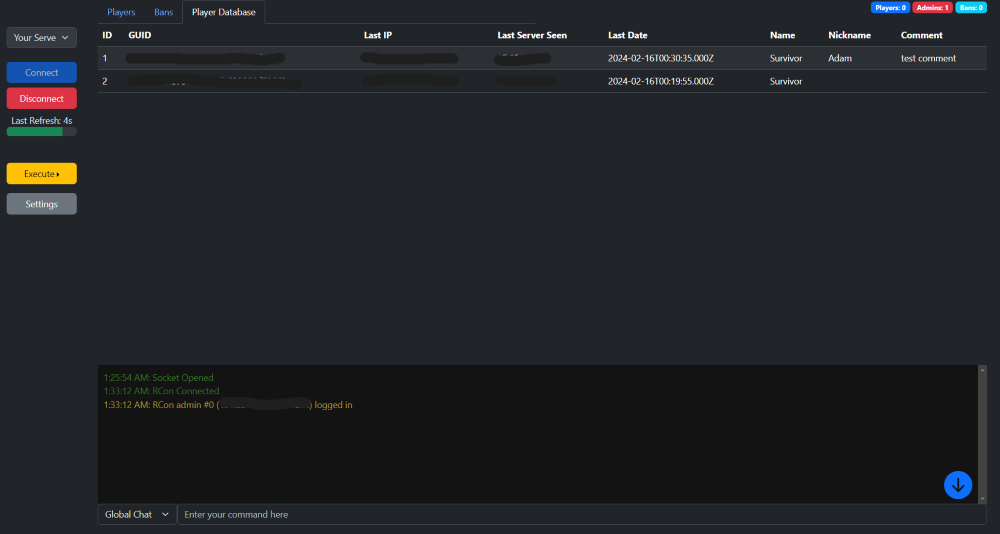
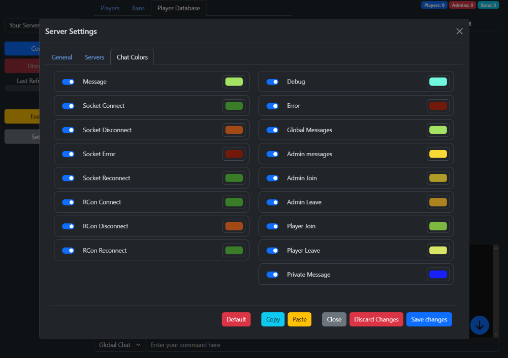
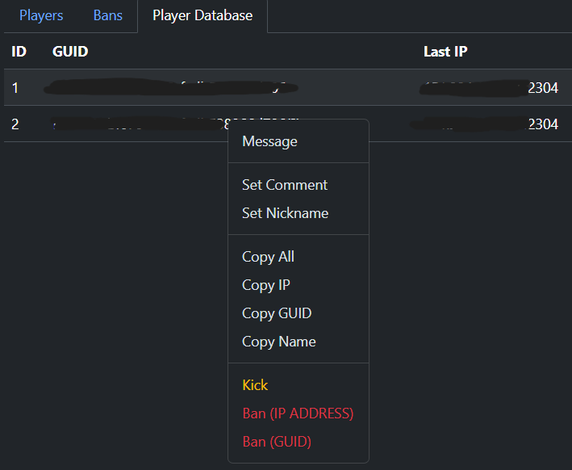
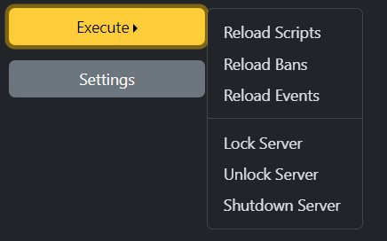
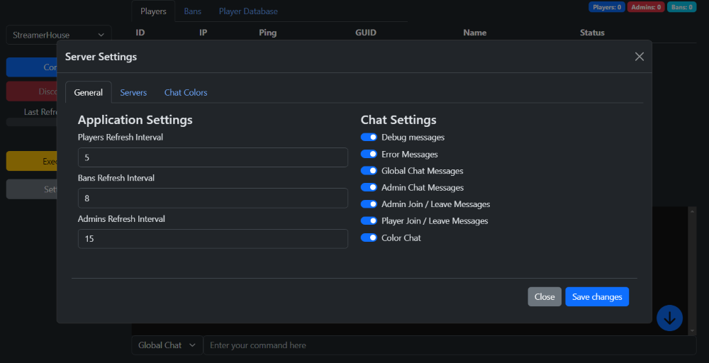
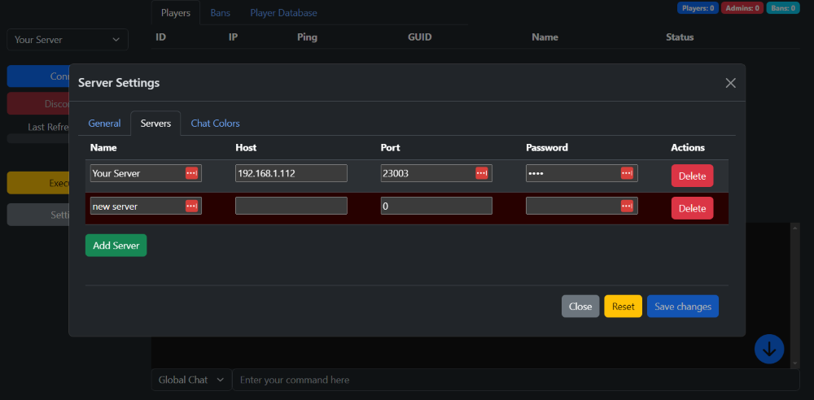
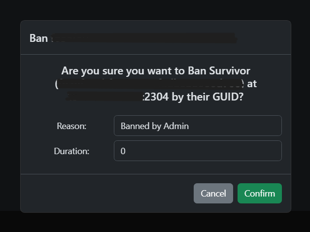
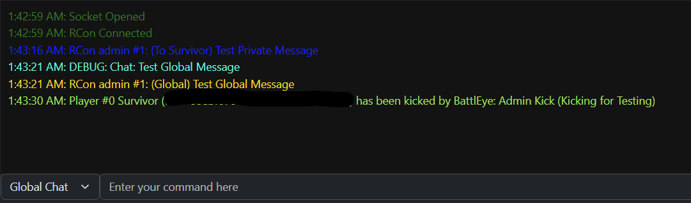
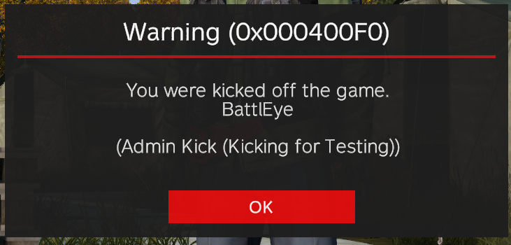

# Node Battleye RCon Client

NART - Node Battleye RCon Client - For connecting to and monitoring Battleye Servers, like DayZ or ARMA.

This has only been tested with a standalone DayZ server.

This app is based on [DaRT](https://github.com/ClintonButler/DaRT---Server-Edition), which I had problems with running and is no longer actively maintained. I decided to create a new version of it using Node.js and TypeScript.

The aim of making this with Node is it can run anywhere, and it's easy to install and run.

This will never require anything to exist on the server, and will never require any changes to the server configuration. The only requirement is that the server has Battleye enabled and you have the login credentials.

## Features
 - Monitoring players connected to the server
 - Monitoring Bans
 - Monitoring Chat
 - Monitoring Server Messages
 - Ability to send RCon commands to the server
 - Ability to send chat messages to the server and private messages to players
 - Ability to Kick, Ban and Unban players
 - Ability to add internal notes and nicknames to players to help identify them
 - Backend Socket Relay between web interface and Battleye. Helps with stability and security, but also UDP4 sockets are not supported in the browser.
 - Encrypted local database to store player data and server login credentials
 - Customizable settings and terminal colors
 - Console log details - Shows player data in pop-ups against log messages
 - Keep track of players' previous in-game names and IPs

## Upcoming Features / TODO
 - Clean up IP Address resolving
 - Allow banning and test
 - Refactor banning to use specific server events
 - Testing? (Need to mock the RCon server - easier said than done when dealing with UDP. Need to write an interface and overload it for testing I think.)
 - Clean up UI
 - Ability to ban by IP and GUID at the same time - TODO: Refactor the form menu to have a drop-down for the type of ban
 - Ability to ban by previous IPs
 - Search for players by Name, IP, GUID
 - Custom scripts to run in the web interface ?
 - Custom commands / aliases
 - Better theming / custom theming
 - Better logging
 - Docker support
 - Notifications for certain events

## Screenshots

NOTE: This project is still early in development, and the UI is not final.



















## Installation

### Linux
```bash

git clone git@github.com:AdamHebby/node-battleye-rcon-client.git && \
    cd node-battleye-rcon-client && \
    npm install && \
    npm run build && \
    npm run start

```

### Windows

Download and [install Node.js](https://nodejs.org/en/download/).

Download the repo as a zip, extract it, and open a command prompt in the directory.

```cmd
npm install
npm run build
npm run start
```

### Docker

TODO